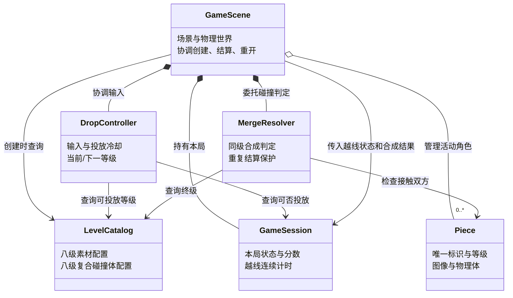

# 《合成大派蒙》系统分析（第 2 轮）

> 本文依据已验收的《需求分析.md》识别主要对象及职责，只分析“谁负责什么、如何协作”，不规定具体文件或代码接口。后续系统设计可细化实现，但不得改变已确定的玩法规则。

## 1. 系统边界与核心流程

玩家在浏览器中操作一个本地单人游戏。系统接收投放输入，创建受物理作用的角色，监听接触并结算合成，更新分数与界面，持续检查失败线。游戏数据只需在当前一局内存在；无需账号、服务器或持久化。

核心流程：

1. **开始**：建立本局状态，准备 1～3 级等概率的待投放角色，显示棋盘、分数与预览。
2. **投放**：接收鼠标/触屏横向位置并限制在棋盘内；创建角色物理体，记录该次投放的 2 秒失败宽限。
3. **碰撞与合成**：物理接触交给合成判定；满足“同级且低于 8 级”时，锁定这两个角色，一次性移除旧角色、创建下一等级并按 `2^L` 加分。
4. **失败监测**：持续检查角色物理轮廓与警戒线；新投放角色宽限期内不计时，之后持续越线 3 秒则结束本局。
5. **重开**：清理物理体、监听和计时数据，重新建立初始局面与 0 分。

## 2. 主要对象与职责

| 对象 | 单一主要职责 | 与谁协作 | 自己保存的状态；不应保存的状态 |
| --- | --- | --- | --- |
| **GameScene（游戏场景）** | 对接 Phaser/Matter.js 的场景生命周期、物理世界和界面；协调其他对象完成开始、结算、结束和重开。 | 接收 `DropController` 的投放请求；根据 `LevelCatalog` 创建 `Piece`；把碰撞交给 `MergeResolver`；通知 `GameSession` 计分/检查失败。 | 保存本局活动角色集合、物理事件订阅和界面引用，以及音效开关等展示层状态；**不**另存一份权威分数或等级规则。 |
| **DropController（投放控制）** | 把鼠标/触屏输入变成合法的投放位置和一次投放请求；控制投放频率与待投放/下一个等级。 | 向 `GameScene` 发送投放请求；从 `LevelCatalog` 允许的 1～3 级随机产生等级；读取 `GameSession` 是否进行中。 | 保存当前待投放等级、下一等级、预览横坐标和短暂投放冷却；**不**保存棋盘角色、分数或物理体。 |
| **Piece（角色实例）** | 表示棋盘上一枚具体角色，连接等级、可见图像和对应物理体。 | 由 `GameScene` 按 `LevelCatalog` 配置创建；其接触事件供 `MergeResolver` 判定；位置供 `GameSession` 失败监测。 | 保存唯一标识、等级、物理体/显示对象引用及是否为新投放角色和释放时间；**不**自行修改分数或决定其他角色是否合成。 |
| **LevelCatalog（等级配置）** | 提供八级不可变配置：贴图/占位图标识、物理尺寸、每级复合碰撞体的部件参数，以及可直接投放的等级范围。 | 供 `GameScene` 创建角色、供 `DropController` 限定随机池、供 `MergeResolver` 核对最高级。 | 保存等级定义数据；**不**保存活动角色、当前分数或本局状态。素材文件来源记录另写清单，不必为其建运行时对象。 |
| **MergeResolver（合成判定）** | 判断接触双方是否可合成并防止重复结算；给出“旧角色 → 新等级”的一次性结算请求。 | 接收 `GameScene` 的碰撞双方；查 `Piece` 等级和 `LevelCatalog` 终级；把有效请求交回 `GameScene` 执行。 | 仅保存当前待结算队列或被锁定的角色标识，结算/重开后清理；**不**直接操纵界面或维护总分。 |
| **GameSession（本局状态）** | 作为当前局的状态与分数唯一来源，负责失败线连续计时、从进行中转为结束和重开归零。 | `GameScene` 通知其成功合成的目标等级、各 `Piece` 的越线情况及开始/重开；`DropController` 查询能否投放。 | 保存 `开始前/进行中/已结束`、总分、每个角色的越线起点及本局失败结果；**不**保存贴图或物理引擎对象。 |

这六个对象足以表达本项目的主要业务。音效播放、界面更新和素材加载先由 `GameScene` 对接现有框架；`LevelCatalog` 只保存素材与碰撞体的**配置**。如果系统设计阶段发现某项职责确实过重，再依据实际依赖拆分，不预先添加空的 `ScoreManager`、`AssetManager` 或 `UIManager`。

## 3. 概念关系图

图中的名称表示分析层的职责单元，不强制对应同名类或同名文件。

## 4. 关键协作与状态所有权

### 4.1 投放

`DropController` 只决定**何时、何处、投放哪个等级**；`GameScene` 负责创建带贴图和复合碰撞体的 `Piece`。新投放时间由 `Piece` 保留，供失败监测使用。1～3 级各 `1/3` 的规则放在投放控制的生成逻辑中，`LevelCatalog` 只声明可投放范围。界面的“当前待投放/下一角色”展示读取投放控制状态，不各自维护一份随机结果。

### 4.2 接触、合成与计分

Matter.js 接触事件由 `GameScene` 接收并映射为两个 `Piece`。`MergeResolver` 检查：两者仍有效、等级相同、等级小于 8、尚未被其他合成锁定。有效请求由 `GameScene` 在安全时机执行：移除两枚旧角色、创建下一级角色，再让 `GameSession` 按目标等级 `L` 增加 `2^L` 分。场景刷新显示；`Piece` 和判定对象都不直接维护总分。

### 4.3 失败判定

`GameScene` 读取每枚活动角色的**物理轮廓**是否越线，并将角色标识、越线状态和当前时间交给 `GameSession`。后者忽略新投放角色释放后的前 2 秒；其余越线状态连续保持 3 秒才转为已结束，回到线下即删除该角色的计时起点。合成新生成的角色不享受“新投放”宽限。场景收到结束状态后停用投放输入、呈现最终分数并播放失败反馈。

### 4.4 重开与资源清理

`GameScene` 清理旧物理体、事件订阅、显示对象和合成队列；`MergeResolver` 清除锁定标识；`GameSession` 清空分数、越线计时和结束状态；`DropController` 重置投放冷却并重新准备等级。音效开关属于展示偏好，可以在重开后保持原选择，不影响本局规则。

## 5. 需求追踪

| 需求编号 | 主要负责对象 |
| --- | --- |
| FR-01、FR-09 | `GameScene`（场景与界面），`GameSession`（状态） |
| FR-02、FR-03 | `DropController`（输入与抽取），`GameScene`（创建物理角色） |
| FR-04 | `MergeResolver`（判定与去重），`GameScene`（实际移除与生成） |
| FR-05、FR-07、FR-08 | `GameSession`（分数、越线、状态），`GameScene`（执行与展示） |
| FR-06、FR-10 | `LevelCatalog`（等级/素材/碰撞配置），`Piece`（单个实例），`GameScene`（加载与调试显示） |

## 6. 后续系统设计需要落实的技术点

- 确定 `Piece` 与 Phaser/Matter.js 游戏对象之间的具体映射，避免图片和物理体各持一套容易失同步的等级/位置。
- 确定碰撞事件后安全结算的时机及锁定释放策略，避免同一角色同时进入两次合成。
- 确定复合碰撞体的配置格式与缩放规则，使八级贴图和物理轮廓一致。
- 确定重开时所有物理事件订阅和计时数据的清理办法。

这些是实现设计问题，不改变已验收的需求，也不需要在本轮创建代码。
