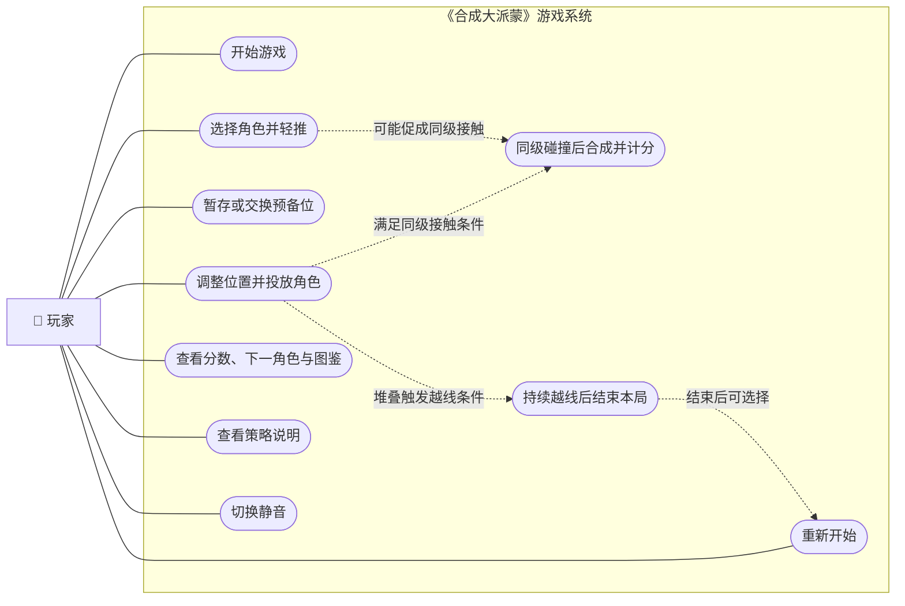
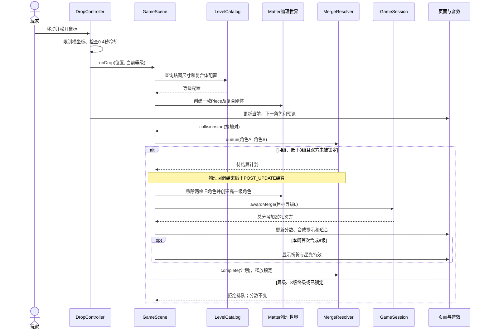
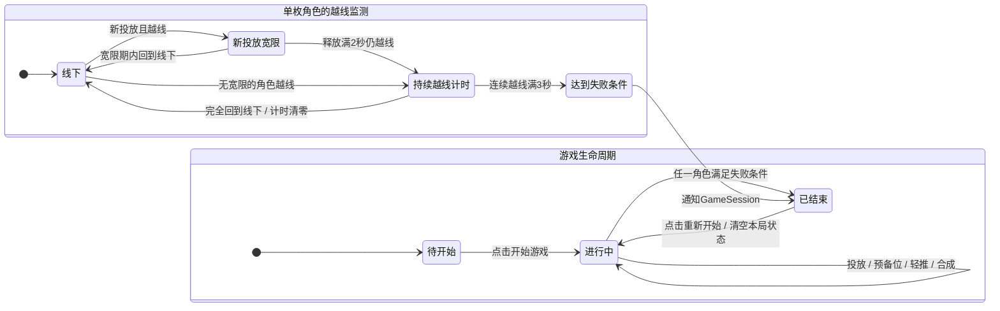

# 《合成大派蒙》面向对象分析图表预览

> 供审阅的独立草稿；原项目报告及其 PDF 未改动。图表依据当前最终版需求与代码，不把开发验收控件、键盘快捷键或未实现的道具列为玩家功能。

## 图 1｜玩家用况图

图中椭圆表示玩家可发起的用况；虚线表示满足条件后由系统自动发生的结果。合成与失败不是玩家直接点击的按钮。

## 表 1｜关键用况说明

| 用况 | 发起者与前置条件 | 基本流程 | 例外或限制、完成结果 |
| --- | --- | --- | --- |
| UC-01 投放角色 | 玩家；已点击开始，尚未失败，投放冷却结束。 | 移动鼠标定位；短虚线显示投放横坐标；在棋盘按下并松开；`DropController` 夹取合法位置，`GameScene` 创建角色并更新当前/下一队列。 | 画布外松开或 0.4 秒冷却期间不投放；出生点不能穿侧壁。新投放角色有 2 秒越线宽限。 |
| UC-02 使用预备位 | 玩家；进行中，当前待投放为 1～3 级，本次投放前尚未使用预备位。 | 点击“暂存 / 交换”；空槽时存入当前角色并启用原下一角色，有存货时交换当前与槽内等级。 | 每次实际投放前最多一次；失败后禁用、重开清空。操作本身不创建棋盘角色或加分。 |
| UC-03 轻推角色 | 玩家；进行中，剩余次数大于 0。 | 点击选择目标；在棋盘选中已落稳的 1～4 级角色；点击左推或右推，对该刚体施加水平力。 | 移动中的角色、5～8 级和空白处不能有效使用；可取消；成功轻推扣一次，每局共两次。轻推本身不加分。 |
| UC-04 查看信息与策略说明 | 玩家；页面已加载。 | 阅读当前分数、下一角色与八级图鉴；点击策略区感叹号展开或收起两种策略的用法。 | 只是读取界面信息，不改变本局分数或角色物理状态。 |
| UC-05 重新开始 | 玩家；本局因持续越线而结束。 | 点击“重新开始”；场景清空旧角色、合成队列和计时，重置分数、待投放队列、预备位、轻推次数与首次 8 级庆祝标记。 | 重新进入可投放状态；旧局的碰撞事件不能在新局继续结算。静音偏好可以保持。 |

## 图 2｜一次同级合成的对象时序图

前提为游戏进行中、投放冷却结束；图示只追踪发生同级接触的路径。异级或两枚 8 级接触时，`MergeResolver` 不生成结算计划。

## 图 3｜游戏生命周期与越线判定状态图

大图表示一局游戏的可见状态；右侧小图表示**每枚角色各自**的越线计时，多个角色可以同时处于不同计时状态。`GameScene` 保存是否已开始，`GameSession` 保存分数、结束标志和逐枚角色的越线起点。

### 核对重点

- 直接随机投放只产生 1～3 级，各占 `1/3`；4～8 级由合成得到，8+8 不合成。
- 图 2 的计分公式以**合成后的目标等级**为 `L`，一次有效合成只加 `2^L` 分。
- 图 3 的 2 秒宽限只给新投放角色；合成生成的角色直接按越线持续 3 秒判定。
- 图表展示需求和对象协作，可作为报告新增章节的候选；是否纳入报告、放在哪一节，由审阅效果后再决定。
