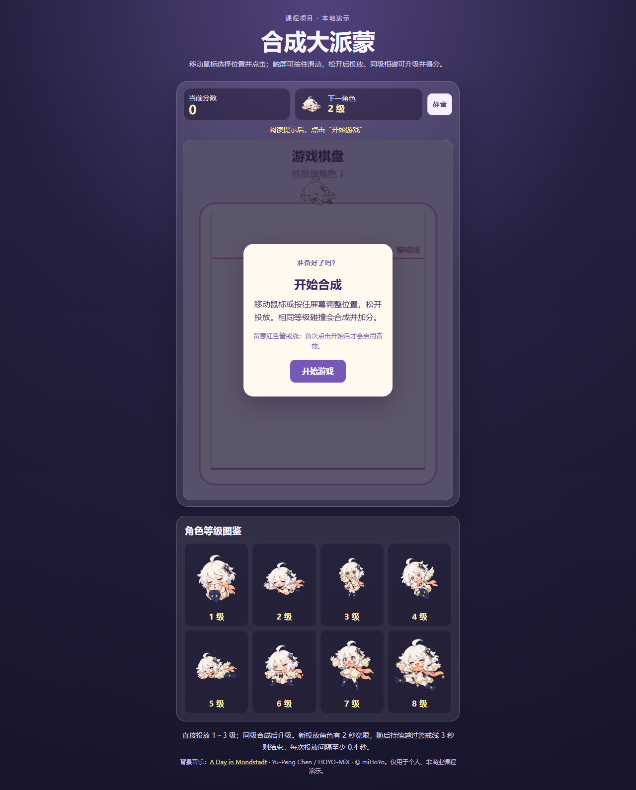
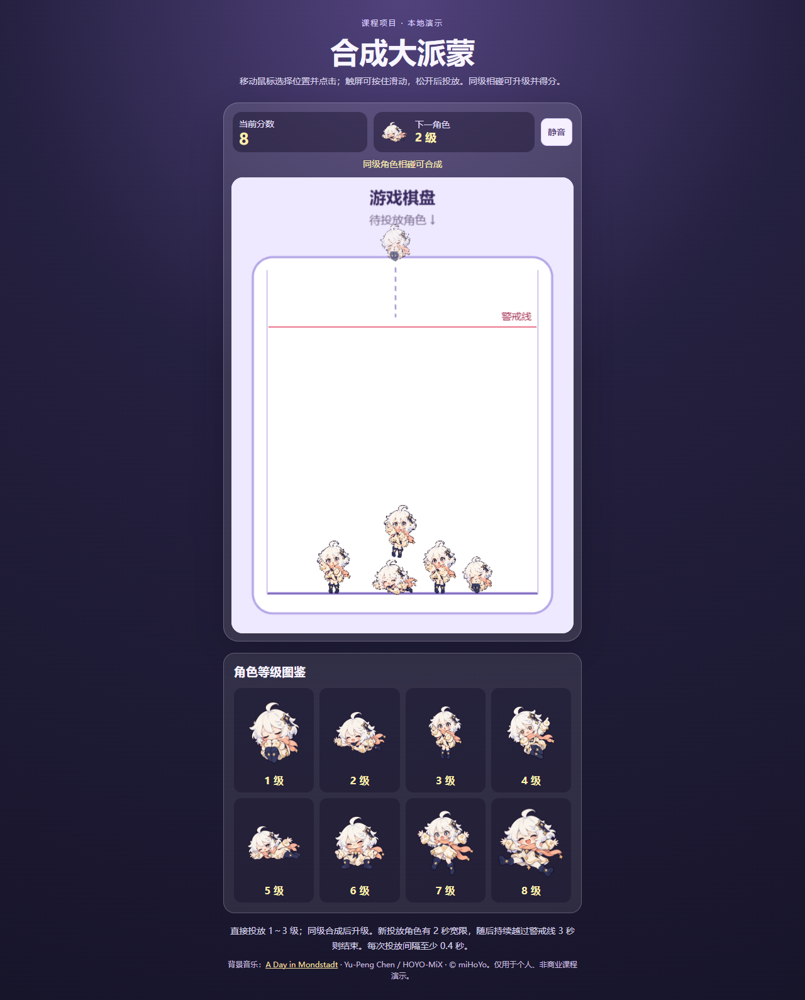

# 《合成大派蒙》Coding Agent 课程项目报告

> 电子版最终稿 · 2026 年 10 月 27 日  
> 项目仓库：[sonata36/OOP-analysis-design](https://github.com/sonata36/OOP-analysis-design) · 在线演示：[Render 站点](https://oop-analysis-design.onrender.com/)  
> 证据依据：真实对话、`docs/开发过程记录.md`、项目源码、终端结果和已保存的运行截图。

## 摘要

本项目是一个浏览器中的单人合成小游戏。玩家移动鼠标或触屏选择横向位置，投放角色；同级角色在 Matter 物理世界中接触后升级并得分，堆叠持续越过警戒线则结束，可重新开始。项目的课程目标是展示“先分析需求，再按可验收子任务与 Coding Agent 自然语言对话，人工检查并反馈修改”的完整过程。用户负责提出规则和验收意见，代码、测试与素材接入由 Agent 执行；项目没有一次性生成全部功能。

最终交付包括 TypeScript + Phaser 3.90 + 内置 Matter.js 游戏、八级独立复合碰撞体、八张透明角色图、开始与结束界面、音效和 BGM、需求/分析/设计文档、逐轮开发记录、自动测试、人工验收表及网页部署。报告中的“用户已验收”仅指对话里的总体确认；未收到逐项设备、耗时和帧率数据，不补写为具体实测。

## 1. 项目概况与功能展示

目标用户是课程教师、同学和体验小游戏的玩家。使用场景是打开本地页面或 Render 网址，阅读开始提示，投放并合成角色，观察分数和下一角色，失败后重新开始。系统不要求账号、后台、排行榜或联网对战；网页部署只负责静态文件访问，玩法在浏览器内运行。

| 固定玩法 | 实际实现 |
| --- | --- |
| 等级与投放 | 共 1～8 级；直接投放只从 1、2、3 级独立等概率抽取，各为 1/3。 |
| 合成与终级 | 同级且低于 8 级的两枚角色接触后升一级；异级不合成，8+8 不合成。 |
| 计分 | 每次成功合成按生成后的等级 L 增加 2^L 分，例如 1+1→2 加 4 分、7+7→8 加 256 分。 |
| 物理与失败 | 重力、侧壁、底板和角色接触由 Matter.js 处理；新投放角色先有 2 秒越线宽限，之后连续越线 3 秒才结束，回到线下重新计时。 |
| 输入与界面 | 鼠标/触屏定位，0.4 秒投放间隔；显示分数、下一角色、投放短虚线、八级图鉴、静音、失败分数和重开入口。 |

角色图为课程演示制作的八张 512×512 透明 PNG，等级与 `lv1.png`～`lv8.png` 一一对应。每级使用不同的 Matter 复合碰撞体；细小装饰不逐像素制作碰撞，以兼顾堆叠稳定性。投放、合成、失败短音由程序合成，BGM 为《A Day in Mondstadt》，来源和权利标识见 `docs/音乐素材清单.md`，并非本项目原创。

## 2. 开发前分析、对象与任务拆分

用户先明确课程重点是通过自然语言与 Agent 分步开发，并要求“每轮先完成一个可验收的子任务”。第 1～4 轮先后验收需求分析、系统分析、系统设计和七任务开发计划；此时没有创建游戏代码。需求文档定义可测规则，系统分析把状态所有权交给真正需要的对象，系统设计核对 Phaser 3.90、Matter 集成和 Vite 的接口及降级方案。

| 主要对象 | 职责及协作 |
| --- | --- |
| `GameScene` | 持有物理世界与活动角色，协调输入、碰撞、界面、结束和重开。 |
| `DropController` | 管理鼠标/触屏位置、1～3 级队列、预览和 0.4 秒冷却。 |
| `LevelCatalog` | 保存八级图片键、尺寸和各级独立复合轮廓配置。 |
| `Piece` 与复合刚体构造 | 把一枚角色的等级、显示对象和 Matter Body 关联起来。 |
| `MergeResolver` | 识别同级有效接触，锁定角色 ID，防止重复合成。 |
| `GameSession` | 保存一局的分数、游戏状态、越线起点和失败结果。 |

数据流是“玩家指针 → 投放控制 → 场景创建角色 → Matter 碰撞 → 合成去重 → 移除旧角色并生成新角色 → 更新分数和界面”。失败检测使用物理体越线情况，不用透明 PNG 的整张画布边界。六个主要职责单元对应实际代码，不为面向对象形式增加空的管理类。七项开发任务依次是：最小页面、基础投放、等级合成与分数、失败重开、复合碰撞体、八张角色图、界面与原创短音。完整验收条件、关系图和文件结构见 `docs/需求分析.md`、`docs/系统分析.md`、`docs/系统设计.md`、`docs/开发计划.md`。

## 3. 与 Coding Agent 的逐步开发过程

下表保留代表性的**用户原话片段**。完整提示词、Agent 实际产出、命令结果和用户反馈逐轮记录于 `docs/开发过程记录.md`；片段用于展示任务边界，不冒充完整聊天记录。

| 阶段 | 代表性用户提示词 | Agent 实际产出与验证 |
| --- | --- | --- |
| 第 1～4 轮：分析与计划 | “本轮不要创建程序代码”；“避免为了‘面向对象’而人为增加空类”；“拆成 7 个颗粒度适中的开发任务”。 | 生成需求、对象关系、系统设计、七任务计划；用户逐轮回复“符合要求”后进入下一项。 |
| T1 / 第 5 轮：最小页面 | “现在只实现开发计划的第一个任务……创建最小可运行页面和游戏画布……不写合成逻辑。” | 建立 `game/`、Vite、Phaser 场景、画布和 README；运行安装、启动及构建检查。 |
| T2 / 第 6 轮：投放与物理 | “上一轮已验收。请只增加单人投放和基础物理……仍使用占位素材，不做合成、计分或结束判定。” | 加入预览、鼠标/触屏、重力与容器碰撞、冷却和边界限制；用户确认“基础投放已验收”。 |
| T3 / 第 7 轮：合成与计分 | “请增加八级角色配置、随机生成低等级角色、同级碰撞合成及计分……避免重复触发、重复加分、物体残留。” | `LevelCatalog`、`MergeResolver`、`GameSession` 和规则测试；核对异级、终级、连续接触及 2^L 计分；用户确认合成和分数已验收。 |
| T4 / 第 8 轮：失败与重开 | “刚投放且还在下落的角色不能立即造成误判……重新开始时清空上一局角色、分数、计时器和监听。” | 警戒线、2 秒宽限、3 秒持续越线、结束层和清理逻辑；用户确认核心循环已验收。 |
| T5 / 第 9 轮：不规则碰撞 | “不能只换贴图、仍统一用圆形碰撞……先验证这两级……再为其余等级补齐配置。” | 先做紧凑型与横向展开型，再补八级独立复合体；保存调试截图和物理模拟测试；用户验收通过。 |
| T6 / 第 10 轮：素材 | “先检查当前项目目录的素材现状，不要声称不存在的图片已经准备好……为 8 个等级制作或接入一套……透明 PNG。” | 核对后制作八张透明角色图，记录来源与等级对应；按可见主体调整碰撞体，并测试缺图占位回退；用户确认玩法及素材已验收。 |
| T7 / 第 11 轮：界面与声音 | “完善开始提示、当前分数、下一角色预览、失败与重开界面、基本响应式布局，以及投放/合成/结束反馈。” | 加入响应式 UI、三类程序合成短音、静音及浏览器手势后启动音频；后续用户对提示字样和尺寸继续提出细化要求。 |

分步顺序使每次变更都能单独验证：在占位角色下先跑通“投放→碰撞→合成→计分→失败→重开”，之后才接入复杂碰撞与正式图片。Agent 输出的测试结果与用户人工验收分别记录，避免把 `npm test` 通过写成真实触屏或听感已通过。

## 4. 人工反馈、修改与复测闭环

课程要求关注“测试发现问题→继续与 AI 对话→定向修改”。本项目保留真实反馈，不为报告虚构缺陷。

| 用户实际反馈或发现 | Agent 的针对性修改 | 可查证结果与边界 |
| --- | --- | --- |
| 第 8 轮后，用户截图显示直接打开 `game/index.html` 时只见文字，游戏画面未启动。 | 为 `file:` 打开方式增加 `game/offline/game.js`、`game/offline/game.css`，保留 Vite 服务版。 | 构建与离线脚本检查成功，历史修复截图保存在 `docs/第10轮_逐级碰撞检查/`；当轮浏览器工具拒绝访问 `file:`，未把工具未测项目写成已测。 |
| 第 11 轮后，用户说：“不需要在每次放置时都显示投放，只在第一次放置时显示投放”。 | 加入每局首次投放标记，成功投放后不再重复显示，重开时重置。 | 后续版本的验收记录与源码对应；没有改变合成反馈。 |
| 用户要求“页面上显示碰撞体功能只在测试阶段使用……添加 BGM”。 | 玩家页移除调试按钮，保留开发期碰撞证据；加入背景音乐控制，使开始后播放、静音同步、失败暂停、重开恢复。 | 构建与音频文件校验成功；正式画面不再显示玩家碰撞调试入口。 |
| 用户指出图鉴存在“可直接投放”“最高级”等多余字样，展示图偏小；又指出 1 级、6/7 级差距和 8 级尺寸问题。 | 删除获取方式标签，放大图鉴图像；调整八级 `radius`，使图片与碰撞体同源缩放。 | 用户原始截图保存为图 4；线上最终版见图 2。该过程是需求细化，不写成自动发现的程序缺陷。 |
| Render 部署显示 Live，但桌面浏览器报 `ERR_CONNECTION_CLOSED`，手机可访问。 | Agent 分别测试网页与音频 HTTP 200，并比较电脑直连与系统代理路径；发现直连成功而系统代理 SSL 失败，指导将站点设为直连。 | 这是访问环境诊断；未修改游戏代码，也未声称远程部署失败。 |

## 5. 测试证据、验收范围与交付

| 检查 | 2026-10-27 实际结果 | 能说明什么 |
| --- | --- | --- |
| `npm test`，位于 `game/` | 12 项通过、0 项失败。 | 覆盖素材规格、八级复合体模拟、1～3 级随机映射、同级合成去重、目标等级计分、2 秒宽限、3 秒持续越线和重开清理。 |
| `npm run build`，位于 `game/` | TypeScript 检查、Vite 构建及 esbuild 离线版构建成功。 | 页面可以生成部署用 `dist/` 和本地打开用离线脚本；Vite 对超过 500 kB 的 Phaser 代码块给出非阻断提示。 |
| 线上浏览器自动采集 | 访问 Render 页面、点击开始并执行六次投放，得到图 1、图 2；采集时页面标题正确、显示 8 分，未捕获页面脚本异常。 | 证明该次浏览器自动流程可启动和投放；不是用户手工完整验收，也不证明所有设备上的音效听感。 |
| 用户人工确认 | 对话中逐轮确认核心规则、复合碰撞、素材和界面，2026-10-21 明确确认当时项目“目前都已人工验收”，2026-10-27 表示项目已完成。 | 记录用户总体结论；未提供端到端表 23 项逐项操作记录、设备型号或浏览器帧率，不补造。 |

项目有 `docs/第12轮_端到端人工验收表.md`，逐项列出启动、投放、物理、合成、分数、终级、越线、重开、复合碰撞、素材、音效和界面的操作及预期。用户的总体确认已注明；表中未取得的逐项测量信息保持未提供状态。开发期 50 个复合体 / 1800 帧的 Matter 计算基准仅反映物理模拟耗时，不能等同于浏览器实际帧率。

运行方式是在 `game/` 执行 `npm install`、`npm run dev`；也可运行 `npm run build` 后打开 `game/index.html`。GitHub 仓库保存源码、素材、离线文件和文档；Render 静态站点从 `main` 分支的 `game/` 目录执行构建，发布 `dist/`。`v1.0.0` 标签记录最初可运行版，之后的 BGM 文件和过程记录已进入 `main`。项目使用的《原神》背景曲非原创，具体文件来源、哈希及权利标识在音乐素材清单中单列。

## 6. 总结与证据索引

本项目证明，Coding Agent 可以在固定规则和可验收边界下承担环境配置、代码生成、图片接入、构建和测试；人通过自然语言约束范围、逐轮验收并指出不符合预期的地方。最有价值的不是一次生成完整游戏，而是把直接打开失败、提示频率、图鉴文字与尺寸等真实反馈转为可复查的定向修改。最终游戏已具备完整基础循环、八级不同轮廓、素材与界面反馈，并形成能追溯提示词与结果的电子报告。

| 证据 | 文件或地址 |
| --- | --- |
| 作业要求 | `D:/QQ_about/files/Coding Agent项目作业介绍.pdf`，第 3、8、23 页。 |
| 原始提示词与逐轮执行 | `docs/开发过程记录.md`；对话稿为 `合成大派蒙_项目需求与AI对话提纲.md`。 |
| 需求、对象、设计与任务 | `docs/需求分析.md`、`docs/系统分析.md`、`docs/系统设计.md`、`docs/开发计划.md`。 |
| 代码、测试与启动 | `game/src/`、`game/tests/`、`game/README.md`、`game/package.json`。 |
| 素材及来源 | `game/assets/characters/`、`docs/素材清单.md`、`docs/音乐素材清单.md`。 |
| 仓库与演示 | [GitHub main](https://github.com/sonata36/OOP-analysis-design)、[Render 站点](https://oop-analysis-design.onrender.com/)。 |

本报告按 2026-10-27 可核实的资料整理。作业 PDF 只说明提交截止时间将在课程 QQ 群通知，本文没有猜测截止日期。
