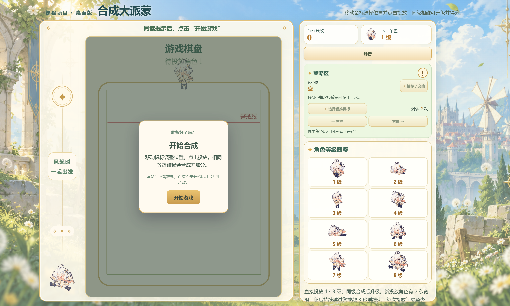
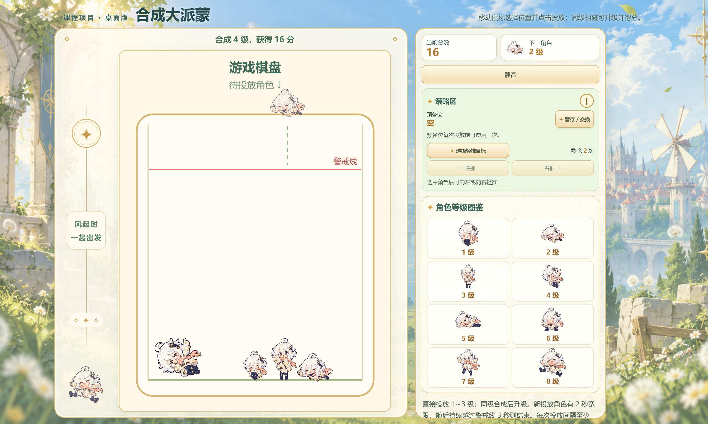
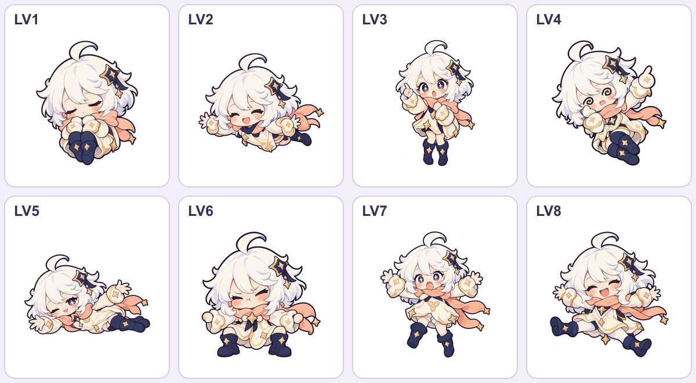
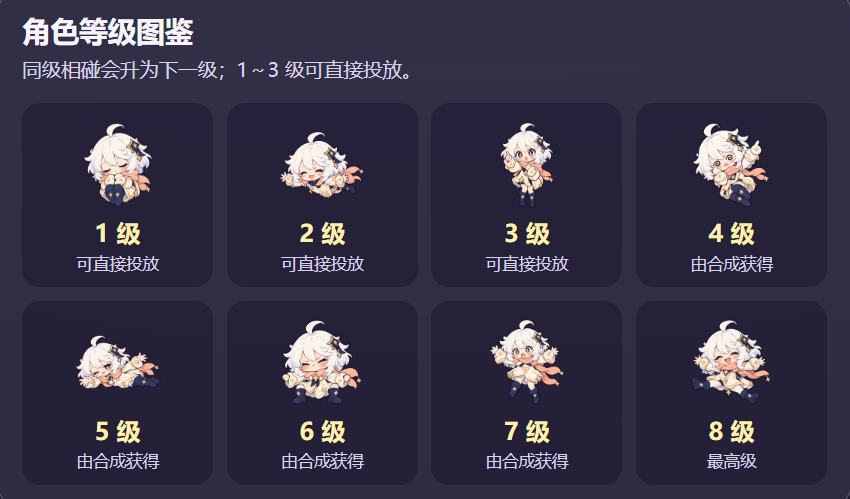

# 面向对象分析与设计项目报告
# 《合成大派蒙》

> 游戏专属仓库：[sonata36/Merge_Paimon](https://github.com/sonata36/Merge_Paimon) · 演示：[merge-paimon.onrender.com](https://merge-paimon.onrender.com/)
> 证据依据：真实对话与开发过程记录、现行源码、实际执行的命令，以及 Render 页面截图。前期七任务与后续桌面迭代共同构成课程项目最终版；历史记录保持其发生时的原貌。

## 摘要

本项目是一个浏览器中的单人合成小游戏。玩家移动鼠标或触屏选择横向位置，投放角色；同级角色在 Matter 物理世界中接触后升级并得分，堆叠持续越过警戒线则结束，可重新开始。项目的课程目标是展示“先分析需求，再按可验收子任务与 Coding Agent 自然语言对话，人工检查并反馈修改”的完整过程。用户负责提出规则和验收意见，代码、测试与素材接入由 Agent 执行；项目没有一次性生成全部功能。

最终版包括 TypeScript + Phaser 3.90 + 内置 Matter 游戏、八级独立复合碰撞体与透明角色图、电脑横版双栏、预备位与轻推、策略说明、8 级首次合成庆祝、开始/结束界面、音效和 BGM。课程前期形成需求、分析、设计与七任务计划；后续依据用户反馈继续迭代，用户现已明确将桌面功能纳入课程项目最终版。报告中的“用户已验收”仅指对话里的总体确认；未取得的设备、耗时和帧率数据不补造。

## 1. 项目概况与功能展示

目标用户是课程教师、同学和体验小游戏的玩家。最终版主要使用场景是在电脑浏览器打开 Render 页面，阅读开始提示，使用鼠标投放和策略按钮，观察分数、下一角色与图鉴，失败后重新开始。窗口宽度不足 1100 像素时页面提示扩大窗口。系统不要求账号、后台、排行榜或联网对战；网页部署只负责静态文件访问，玩法在浏览器内运行。

| 固定玩法 | 实际实现 |
| --- | --- |
| 等级与投放 | 共 1～8 级；直接投放只从 1、2、3 级独立等概率抽取，各为 1/3。 |
| 合成与终级 | 同级且低于 8 级的两枚角色接触后升一级；异级不合成，8+8 不合成。 |
| 计分 | 每次成功合成按生成后的等级 L 增加 2^L 分，例如 1+1→2 加 4 分、7+7→8 加 256 分。 |
| 物理与失败 | 重力、侧壁、底板和角色接触由 Matter.js 处理；新投放角色先有 2 秒越线宽限，之后连续越线 3 秒才结束，回到线下重新计时。 |
| 输入与界面 | 当前桌面版用鼠标定位和按钮操作，0.4 秒投放间隔；显示分数、下一角色、投放短虚线、八级图鉴、静音、失败分数和重开入口。底层仍保留触屏指针处理。 |
| 最终版策略 | 预备位可暂存或交换 1～3 级待投放角色，每次实际投放前至多使用一次；每局可轻推两次，只能选已落稳的 1～4 级角色，方向由鼠标点击按钮确定。策略不直接得分；感叹号按钮可展开两种策略说明。 |
| 终级反馈 | 本局首次合成 8 级时显示“恭喜合成开心大派蒙”与暖金、草绿特效；8 级仍是不可再合成的终级。 |

角色图为课程演示制作的八张 512×512 透明 PNG，等级与 `lv1.png`～`lv8.png` 一一对应。每级使用不同的 Matter 复合碰撞体；细小装饰不逐像素制作碰撞，以兼顾堆叠稳定性。投放、合成、失败短音由程序合成，BGM 为《A Day in Mondstadt》，来源和权利标识见 `docs/音乐素材清单.md`，并非本项目原创。

## 2. 开发前分析、对象与任务拆分

用户先明确课程重点是通过自然语言与 Agent 分步开发，并要求“每轮先完成一个可验收的子任务”。第 1～4 轮先后验收需求分析、系统分析、系统设计和七任务开发计划；此时没有创建游戏代码。需求文档定义可测规则，系统分析把状态所有权交给真正需要的对象，系统设计核对 Phaser 3.90、Matter 集成和 Vite 的接口及降级方案。

| 主要对象 | 职责及协作 |
| --- | --- |
| `GameScene` | 持有物理世界与活动角色，协调碰撞、轻推选中与次数、首次 8 级庆祝、界面、结束和重开。 |
| `DropController` | 管理指针位置、1～3 级当前/下一队列、预览、0.4 秒冷却，以及预备位、每次投放前一次的使用标记。 |
| `LevelCatalog` | 保存八级图片键、尺寸和各级独立复合轮廓配置。 |
| `Piece` 与复合刚体构造 | 把一枚角色的等级、显示对象和 Matter Body 关联起来。 |
| `MergeResolver` | 识别同级有效接触，锁定角色 ID，防止重复合成。 |
| `GameSession` | 保存一局的分数、游戏状态、越线起点和失败结果。 |
| `SoundFeedback` / `BackgroundMusic` | 分别负责程序合成短音与本地 BGM，接受场景发出的播放、暂停和静音请求。 |

核心数据流是“玩家指针 → `DropController` → `GameScene` 创建角色 → Matter 碰撞 → `MergeResolver` 去重 → `GameSession` 计分与判负 → DOM 更新”。预备位只改变待投放队列，不创建棋盘角色；轻推由场景选定稳定且合格的角色，再向其 Matter Body 施加水平力，后续合成仍走同一判定链。失败检测使用物理体越线情况，不用透明 PNG 的整张画布边界。这些职责对应实际代码，没有为面向对象形式增加空类。课程七项任务依次是最小页面、基础投放、合成计分、失败重开、复合碰撞体、角色图、界面与短音；完整验收条件、关系图和文件结构见 `docs/需求分析.md`、`docs/系统分析.md`、`docs/系统设计.md`、`docs/开发计划.md`。

在设计上，`LevelCatalog` 集中保存等级尺寸、纹理和碰撞轮廓；`Piece` 只标识一枚角色的等级、图像与物理体；`MergeResolver` 锁定参与合成的 ID，避免多次碰撞回调重复加分。场景负责组合这些对象并处理生命周期。画布逻辑坐标保持 480×640，`DisplayScale` 根据显示密度提高实际绘制像素，输入先转换为相机世界坐标，因此高清显示不改变物理、投放和轻推规则。CSS 根据窗口高度控制棋盘尺寸；右栏独立滚动，宽屏左侧装饰不会覆盖棋盘。

## 3. 与 Coding Agent 的逐步开发过程

下表保留代表性的**用户原话片段**。完整提示词、Agent 实际产出、命令结果和用户反馈逐轮记录于 `docs/开发过程记录.md`；片段用于展示任务边界，不冒充完整聊天记录。

| 阶段 | 代表性用户提示词 | Agent 实际产出与验证 |
| --- | --- | --- |
| 第 1～4 轮：分析与计划 | “本轮不要创建程序代码”；“避免为了‘面向对象’而人为增加空类”；“拆成 7 个颗粒度适中的开发任务”。 | 生成需求、对象关系、系统设计、七任务计划；用户逐轮回复“符合要求”后进入下一项。 |
| T1 / 第 5 轮：最小页面 | “现在只实现开发计划的第一个任务……创建最小可运行页面和游戏画布……不写合成逻辑。” | 建立 `game/`、Vite、Phaser 场景、画布和 README；运行安装、启动及构建检查。 |
| T2 / 第 6 轮：投放与物理 | “上一轮已验收。请只增加单人投放和基础物理……仍使用占位素材，不做合成、计分或结束判定。” | 加入预览、鼠标/触屏、重力与容器碰撞、冷却和边界限制；用户确认“基础投放已验收”。 |
| T3 / 第 7 轮：合成与计分 | “请增加八级角色配置、随机生成低等级角色、同级碰撞合成及计分……避免重复触发、重复加分、物体残留。” | `LevelCatalog`、`MergeResolver`、`GameSession` 和规则测试；核对异级、终级、连续接触及 2^L 计分；用户确认合成和分数已验收。 |
| T4 / 第 8 轮：失败与重开 | “刚投放且还在下落的角色不能立即造成误判……重新开始时清空上一局角色、分数、计时器和监听。” | 警戒线、2 秒宽限、3 秒持续越线、结束层和清理逻辑；用户确认核心循环已验收。 |
| T5 / 第 9 轮：不规则碰撞 | “不能只换贴图、仍统一用圆形碰撞……先验证这两级……再为其余等级补齐配置。” | 先做紧凑型与横向展开型，再补八级独立复合体；保存调试截图和物理模拟测试；用户验收通过。 |
| T6 / 第 10 轮：素材 | “先检查当前项目目录的素材现状，不要声称不存在的图片已经准备好……为 8 个等级制作或接入一套……透明 PNG。” | 核对后制作八张透明角色图，记录来源与等级对应；按可见主体调整碰撞体，并测试缺图占位回退；用户确认玩法及素材已验收。 |
| T7 / 第 11 轮：界面与声音 | “完善开始提示、当前分数、下一角色预览、失败与重开界面、基本响应式布局，以及投放/合成/结束反馈。” | 加入响应式 UI、三类程序合成短音、静音及浏览器手势后启动音频；后续用户对提示字样和尺寸继续提出细化要求。 |

基础七任务完成后，用户继续按实际页面反馈推进最终版：先要求“做成电脑端的专属，将页面改为‘横版’”，随后确认“全程用鼠标操作”，提出阳光温馨主题、预备位和轻推、首次 8 级庆祝、策略帮助，并以 Render 截图指出 8 级占位、页面比例、模糊和装饰遮挡。Agent 对应调整 `index.html`、`style.css`、`GameScene`、`DisplayScale` 与资源发布路径，再将项目转入专属仓库和站点。用户最后明确“当前版本不再为自拓展，而是作为项目的最终版”；这改变的是**交付范围**，不改变上述工作的真实发生时间。提示词摘录与证据索引见开发过程记录的最终版补记和本报告第 4～6 节。

分步顺序使每次变更都能单独验证：在占位角色下先跑通“投放→碰撞→合成→计分→失败→重开”，之后才接入复杂碰撞与正式图片。Agent 输出的测试结果与用户人工验收分别记录，避免把 `npm test` 通过写成真实触屏或听感已通过。

## 4. 人工反馈、修改与复测闭环

课程要求关注“测试发现问题→继续与 AI 对话→定向修改”。本项目保留真实反馈，不为报告虚构缺陷。

| 用户实际反馈或发现 | Agent 的针对性修改 | 可查证结果与边界 |
| --- | --- | --- |
| 第 8 轮后，用户截图显示直接打开 `game/index.html` 时只见文字，游戏画面未启动。 | 为 `file:` 打开方式增加 `game/offline/game.js`、`game/offline/game.css`，保留 Vite 服务版。 | 构建与离线脚本检查成功，历史修复截图保存在 `docs/第10轮_逐级碰撞检查/`；当轮浏览器工具拒绝访问 `file:`，未把工具未测项目写成已测。 |
| 第 11 轮后，用户说：“不需要在每次放置时都显示投放，只在第一次放置时显示投放”。 | 加入每局首次投放标记，成功投放后不再重复显示，重开时重置。 | 后续版本的验收记录与源码对应；没有改变合成反馈。 |
| 用户要求“页面上显示碰撞体功能只在测试阶段使用……添加 BGM”。 | 玩家页移除调试按钮，保留开发期碰撞证据；加入背景音乐控制，使开始后播放、静音同步、失败暂停、重开恢复。 | 构建与音频文件校验成功；正式画面不再显示玩家碰撞调试入口。 |
| 用户指出图鉴存在“可直接投放”“最高级”等多余字样，展示图偏小；又指出 1 级、6/7 级差距和 8 级尺寸问题。 | 删除获取方式标签，放大图鉴图像；调整八级 `radius`，使图片与碰撞体同源缩放。 | 用户原始截图保存为图 4；线上最终版见图 2。该过程是需求细化，不写成自动发现的程序缺陷。 |
| Render 部署显示 Live，但桌面浏览器报 `ERR_CONNECTION_CLOSED`，手机可访问。 | Agent 分别测试网页与音频 HTTP 200，并比较电脑直连与系统代理路径；发现直连成功而系统代理 SSL 失败，指导将站点设为直连。 | 这是访问环境诊断；未修改游戏代码，也未声称远程部署失败。 |

## 5. 纳入最终交付的桌面版迭代

用户曾在课程报告完成后把下一阶段称为“作业外自拓展”，所以第 1～21 轮的历史记录没有把这些工作提前写成原七项任务。现在用户明确将当前桌面版定为**课程项目最终版**。本节说明后续真实迭代如何成为最终交付的一部分，同时保留任务发生的先后顺序和验收证据边界。

| 最终版新增需求与用户反馈 | 现行设计和实现 | 验收关注点 |
| --- | --- | --- |
| 电脑端专属横版：中左游玩，右侧展示和策略。 | CSS 双栏；左侧保持 3:4 棋盘，右侧集中分数、下一角色、静音、技能和八级图鉴。高度不足时棋盘等比缩小，右栏独立滚动；宽度不足 1100 像素给出提示。 | 棋盘完整、图鉴可滚动、无横向溢出。 |
| 全程鼠标操作。 | 预备位、轻推选择、方向和取消均使用可点击按钮；轻推模式下点击棋盘只选目标，不投放。 | 按钮状态与提示一致，误点不消耗道具。 |
| 策略区需要即时说明。 | 右上圆形感叹号按钮展开/收起预备位与轻推说明，界面为按钮维护展开状态。 | 两段说明与实际限制一致，鼠标可开合。 |
| 预备位和轻推。 | 预备位状态归 `DropController`，仅操作当前 1～3 级角色；每次实际投放前一次。轻推次数、选中 ID 与模式归 `GameScene`，每局两次，只推落稳的 1～4 级，水平力为 `方向 × 质量 × 0.007`；由用户反馈从 0.006 小幅调高。 | 暂存/交换、次数限制、重开复位；轻推引发合成时只按原公式加分。 |
| 阳光温馨的主题和原神特色。 | 使用原创生成的晴天风车城背景、既有八级透明派蒙图、草绿与暖金配色；左侧延长的面板放置星形徽记、细线、文字和左下派蒙装饰。背景来源见 `game/assets/backgrounds/README.md`。 | 主体文字可读，装饰不挡棋盘；窄布局不出现多余空栏。 |
| 角色可读性和首次合成 8 级反馈。 | 放大并分级调整图片与复合碰撞体，图鉴仅显示图片和等级；本局第一次生成 8 级时显示“恭喜合成开心大派蒙”和配色一致的特效。 | 视觉尺寸与物理轮廓同步，庆祝只触发一次。 |
| 新 Render 页面中 8 级一度显示数字占位、页面过高、棋盘角色模糊。 | 修正 8 级资源发布路径；扩大桌面棋盘与侧栏，按显示密度提高画布绘制像素，并把投放和轻推选点映射到世界坐标。新站点使用 `sonata36/Merge_Paimon` 的 `main` 分支。 | 8 张图正常加载，画布角色清晰，鼠标落点准确，首屏比例合理。 |

这些迭代沿用原有对象边界：预备位改变 `DropController` 队列，轻推改变现有 Matter 刚体状态，合成与计分继续复用 `MergeResolver` 和 `GameSession`。`GameScene` 保存轻推次数、选中目标和本局庆祝状态；`DisplayScale` 提升绘制像素而不改变 480×640 的逻辑物理坐标。最终版不引入第二套合成规则，也不提供键盘快捷键或应急回收。第三方 BGM《A Day in Mondstadt》仅按项目负责人的个人、非商业课程演示用途随仓库提供；这不是对曲目的再授权，详情见 `docs/音乐素材清单.md`。

## 6. 测试证据、验收范围与交付

| 检查 | 实际结果 | 能说明什么 |
| --- | --- | --- |
| `npm test`，位于 `game/` | 12 项通过、0 项失败。 | 覆盖素材规格、八级复合体模拟、1～3 级随机映射、同级合成去重、目标等级计分、2 秒宽限、3 秒持续越线和重开清理。 |
| `npm run build`，位于 `game/` | TypeScript 检查、Vite 构建及 esbuild 离线版构建成功。 | 页面可以生成部署用 `dist/` 和本地打开用离线脚本；Vite 对超过 500 kB 的 Phaser 代码块给出非阻断提示。 |
| `npm run benchmark:physics`，位于 `game/`，2026-10-29 | 50 个复合体、1800 帧模拟耗时 848.3 ms，平均 0.471 ms/帧。 | 只反映本机 Node 中的 Matter 计算，不包括浏览器绘制、输入和真实设备帧率。 |
| 新 Render 线上浏览器自动采集，2026-10-29 | 访问 `https://merge-paimon.onrender.com/`，点击开始并执行五次投放，得到图 1、图 2；采集时显示 16 分，8 张图鉴图片加载，画布实际像素为 1440×1920，没有横向溢出或页面脚本异常。 | 证明该次桌面浏览器流程可启动、投放并显示新版布局；不是用户手工完整验收，也不证明所有设备上的音效听感。 |
| 用户人工确认 | 对话中逐轮确认核心规则、复合碰撞、素材和界面，2026-10-21 明确确认当时项目“目前都已人工验收”，2026-10-27 表示项目已完成；后续桌面迭代曾获“验收后未发现问题”“已确认没有问题”的反馈。 | 记录用户对相关阶段的总体结论；最终版补充表的逐项设备、音效听感和帧率未提供，不补造。 |

项目有 `docs/第12轮_端到端人工验收表.md`，历史 E01～E23 覆盖基础玩法；最终版 F01～F08 补充桌面布局、高清素材、预备位、轻推、策略帮助、终级庆祝、鼠标选点与音频。用户的总体确认已注明；表中未取得的逐项测量信息保持未提供状态。50 个复合体 / 1800 帧的 Matter 计算基准仅反映物理模拟耗时，不能等同于浏览器实际帧率。

运行方式是在 `game/` 执行 `npm install`、`npm run dev`；也可运行 `npm run build` 后打开 `game/index.html`。最终 GitHub 仓库保存源码、素材、离线文件和文档；Render 静态站点从 `sonata36/Merge_Paimon` 的 `main` 分支发布 `game/dist` 构建产物。可复现的静态站点配置见 `game/README.md`；服务控制台中的实际命令未在本报告中核对。原仓库 `sonata36/OOP-analysis-design` 及其 `v1.0.0` 标签记录早期可运行版；报告以新仓库和新 Render 页面为最终交付。项目使用的《原神》背景曲非原创，具体文件来源、哈希及权利标识在音乐素材清单中单列。

## 7. 总结与证据索引

本项目展示了从固定规则与对象职责出发，逐步实现并验证投放、碰撞、合成、计分、失败和重开的过程。后续真实用户反馈推动了横版布局、鼠标策略、画布清晰度、终级庆祝和主题装饰，并已纳入课程项目最终版。每次迭代继续复用既有领域对象，保留原规则和证据边界；开发记录可追溯真实提示词，Render 页面反映当前产品状态。

| 证据 | 文件或地址 |
| --- | --- |
| 作业要求 | `D:/QQ_about/files/Coding Agent项目作业介绍.pdf`，第 3、8、23 页。 |
| 原始提示词与逐轮执行 | `docs/开发过程记录.md`；对话稿为 `合成大派蒙_项目需求与AI对话提纲.md`。 |
| 需求、对象、设计与任务 | `docs/需求分析.md`、`docs/系统分析.md`、`docs/系统设计.md`、`docs/开发计划.md`。 |
| 代码、测试与启动 | `game/src/`、`game/tests/`、`game/README.md`、`game/package.json`。 |
| 素材及来源 | `game/assets/characters/`、`docs/素材清单.md`、`docs/音乐素材清单.md`。 |
| 仓库与演示 | [Merge_Paimon main](https://github.com/sonata36/Merge_Paimon)、[Render 站点](https://merge-paimon.onrender.com/)。 |

## 8. 最终版需求追踪与复测重点

前期固定玩法由 FR-01～FR-10 定义，后续正式纳入的桌面功能由 FR-11～FR-16 定义。需求、对象职责、落地模块和人工操作形成可追踪关系：

| 最终版需求 | 负责模块及交付证据 | 需要观察的结果 |
| --- | --- | --- |
| FR-11 桌面双栏 | `index.html`、`style.css`、`DisplayScale.ts`；Render 开始/游玩截图 | 1366×768 与 1920×1080 下棋盘完整、右栏可滚动；窄窗口提示。 |
| FR-12 预备位 | `DropController.ts`、`GameScene.ts` | 每次投放前最多一次；暂存/交换、失败禁用、重开清空。 |
| FR-13 两次轻推 | `GameScene.ts`、Matter 刚体 | 只推已落稳 1～4 级；有效使用扣一次；合成仍按原规则。 |
| FR-14 帮助和终级庆祝 | `index.html`、`GameScene.ts`、`style.css` | 感叹号可开合；每局首次合成 8 级出现祝贺与暖金草绿特效。 |
| FR-15 主题与高清素材 | `game/assets/`、`LevelCatalog.ts`、`DisplayScale.ts` | 八张图清楚且无数字占位，鼠标落点与虚线对应，左下装饰无遮挡。 |
| FR-16 静态发布 | `vite.config.ts`、`game/README.md`、`Merge_Paimon` 仓库及 Render 站点 | `npm run build` 成功；线上页面和角色、背景、BGM 资源加载。 |

本次重新执行的自动测试与构建结果见第 6 节。策略帮助的开合、预备位和轻推的鼠标手感、终级庆祝、声音听感与不同桌面窗口表现仍应按 `docs/第12轮_端到端人工验收表.md` 的 F01～F08 手工复测并填写真实结果。报告未把代码存在或构建成功写成这些人工项已逐项通过。
